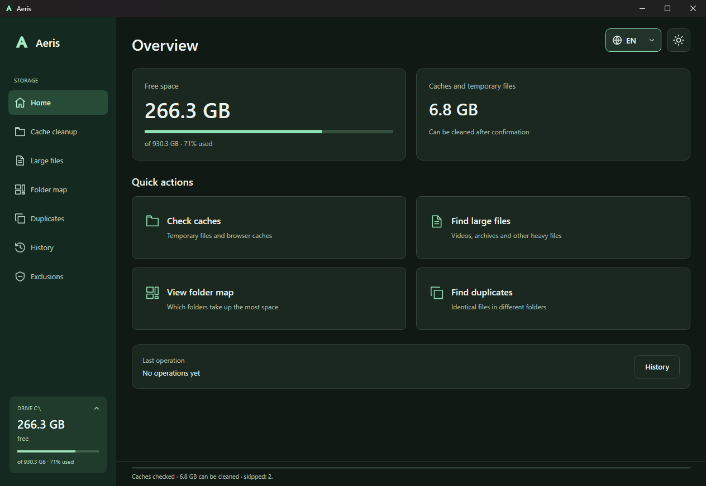

# Aeris

A disk space analyzer and cache cleaner for Windows and Linux. Find large files and duplicates, explore folder sizes, and review cache files before removing them.

Windows and Linux have desktop apps. A standalone CLI is available for scripts and Linux servers. File analysis stays local; Aeris collects no telemetry.



[](https://github.com/mayskiiyy/Aeris/actions/workflows/build.yml)
[](https://github.com/mayskiiyy/Aeris/releases/latest)
[](LICENSE)

[Download](https://github.com/mayskiiyy/Aeris/releases/latest) · [User guide](docs/user-guide.md) · [Platform support](#platform-support) · [Install](#install) · [Command line](#command-line) · [Build from source](#build-from-source)

## What you can do

- **Find what takes up space.** Explore a folder map, inspect the largest files and export reports to CSV.
- **Review caches before cleaning.** Search categories, choose an age limit and inspect individual files before confirming.
- **Find duplicate files.** Exact matches are verified with SHA-256; hashes of unchanged files are cached for later scans.
- **Keep a recovery option.** Move caches to quarantine and restore them from History. Permanent cache deletion is also available when explicitly selected.
- **Automate routine cleanup.** Use the CLI, Windows Task Scheduler or optional Linux systemd user units.

## First run

1. Open **Large files** or **Folder map** on Windows, or **Disk usage** on Linux. Choose a folder and scan it. Scanning only reports files; it does not remove them.
2. Before your first Windows cache cleanup, open **Settings** and choose **Quarantine** if you want a recovery option. The Windows default is **permanent deletion**. The Linux GUI always uses quarantine.
3. Close the apps whose caches you want to clean. In **Cache cleanup**, choose categories and an age limit (7 days is a conservative starting point), then check caches.
4. Open the review, inspect the complete file list and exclude anything you want to keep before confirming. Search and category filters do not clear hidden selections.
5. Read the result in **History**. Restore quarantined caches there; restore recycled personal files from the system Recycle Bin or trash. Permanent deletion cannot be undone in Aeris.

Open **Help** or press **F1** in either desktop app for an offline guide in the interface language. The [user guide](docs/user-guide.md) covers each workflow, recovery, shortcuts and troubleshooting.

On Windows, the home page searches functions, settings, available cache categories and help topics. Use **Ctrl+K** from any tab, or **Ctrl+F** on Home. Click a result to open it; Enter opens the first result. Scrollable areas also support middle-button autoscroll: click and move the mouse, then click again or press Esc to stop.

Quarantine and the Recycle Bin still occupy disk space. Windows may purge quarantined operations when they exceed the age or size limit, so the retention period is not a guaranteed recovery window.

## Platform support

| Feature | Windows GUI | Linux GUI | Linux CLI |
| --- | --- | --- | --- |
| Disk usage and largest files | Yes | Treemap, folder navigation, largest 500, CSV | Scan reports and CSV |
| Exact duplicates | Review and recycle | Report and open location | Report; optional desktop trash |
| Cache cleanup | Permanent or quarantine | Per-file review and quarantine | Dry run, permanent or quarantine |
| History and quarantine restore | Yes | Yes | Yes |
| Similar images | Yes | Not yet | Not yet |
| Empty folders and zero-byte files | Yes | Not yet | Yes |
| Scheduling | Task Scheduler settings | Optional systemd units | systemd or another scheduler |
| Updates | Offer, verify and run installer; portable ZIP download | Offer and verify archive; manual install | Download a new release manually |

### Linux limitations

The Linux desktop app currently reports exact duplicates but does not delete them. Similar-image search and the empty-folder/zero-byte-file view are not implemented in the Linux GUI. Similar-image search is also unavailable in the Linux CLI. Linux desktop updates download a verified archive and require manual installation.

Linux builds target glibc on x64 and ARM64. Alpine/musl is not supported; the desktop requires X11 or XWayland. See [Linux installation](#linux-desktop-and-servers) for dependencies and server setup.

## Windows features

<details>
<summary>Full Windows feature list</summary>

- Cache cleanup for Windows, every installed browser Aeris knows, GPU shader caches, Steam, developer tools (npm, Yarn, pip, NuGet, Gradle) and a few Electron apps. Only files whose creation and modification dates are both older than the retention period you pick (2 days minimum) are touched. The full list is in [How cleanup works](#how-cleanup-works).
- Cache categories can be filtered by purpose and searched by name, description or path. Choose categories before checking; the scan preserves that choice. Before anything is deleted you see every file in a review window, with search, sorting and per-file or per-category exclusion.
- Cache files can be deleted permanently or moved to a quarantine for 1 to 30 days. History restores a quarantined cleanup with the original dates and never overwrites a file that took its place.
- A list of the 200 largest files in any folder or drive, filtered by type and minimum size, with CSV export.
- A folder map that shows one level at a time with readable names and sizes, a complete list next to it, breadcrumbs, logical size or size on disk, and a context menu. Click a folder to explore it; small entries are grouped and file-type totals are available on demand. Scanning reads folders in parallel and counts hard links once.
- Duplicate search by size, a quick check of the first and last 64 KB, and full SHA-256. Hashes of unchanged files are cached, so a second search is much faster. Rules pick which copy stays (oldest, newest, shortest path or name, folders with originals, folders that are never touched).
- Similar image search (resized, re-saved or slightly cropped copies) with side-by-side previews and the best copy marked. Completed hashes survive cancellation, and equal visual hashes are grouped without repeated pairwise comparisons. Inputs above 256 MiB, 32,768 pixels on either side or 100 million pixels are skipped. Native image decoding still runs in the app process; size limits do not provide sandboxing or a hard timeout.
- Empty folders and 0-byte files. Folders that belong to Windows or to apps are never offered.
- Personal files (duplicates, similar images, large files, empty folders) only ever go to the Recycle Bin, and each duplicate group always keeps at least one copy.
- `aeris-cli` for scripts, and an optional scheduled cleanup of Safe categories through Windows Task Scheduler.
- Optional Explorer context menu entries for folders and drives.
- A history of every operation with a per-file log, folder exclusions that apply everywhere, light and dark themes.
- Eight interface languages: English, Deutsch, Русский, Українська, Français, Español, Português (Brasil) and Polski. On first launch Aeris picks the Windows display language and falls back to English.

</details>

## Install

All packages include the .NET runtime; you do not need to install it separately. Download a package from [Releases](https://github.com/mayskiiyy/Aeris/releases/latest).

### Windows

Requires Windows 10 or 11 (x64).

- `Aeris-<version>-Setup-x64.exe` installs Aeris and `aeris-cli.exe` for the current user. It does not need administrator rights.
- `Aeris-<version>-win-x64.zip` is the portable build: `Aeris.exe`, `aeris-cli.exe` and the license files. Unpack it anywhere and run it.
- `aeris-cli-<version>-win-x64.exe` is the command-line tool on its own.

Or install it with winget:

```powershell
winget install MAYSKIY.Aeris
```

Release binaries are currently unsigned, so Windows may show a SmartScreen warning, including when installing through winget. To check a download's integrity, run `Get-FileHash .\Aeris-<version>-Setup-x64.exe -Algorithm SHA256` in PowerShell and compare the result with `SHA256SUMS.txt` from the same release. A matching checksum does not establish a trusted publisher identity.

Settings, history, quarantine and caches of hashes are stored in `%LOCALAPPDATA%\Aeris`. Uninstalling the app leaves that folder in place, but removes the scheduled task and the Explorer menu entries.

### Linux desktop and servers

Linux packages start with version 1.1. Choose `linux-x64` for Intel/AMD or `linux-arm64` for ARM64. These are glibc builds for Ubuntu 22.04+, Debian 13+ and compatible systems supported by .NET 10; Alpine/musl is not supported. Ubuntu 24.04 x64 is the runtime validation environment.

- `Aeris-<version>-linux-<arch>.tar.gz`: desktop app, CLI, desktop-menu installer and optional systemd user units.
- `aeris-cli-<version>-linux-<arch>.tar.gz`: CLI and optional user units, with no desktop requirement.

Check the archive against `SHA256SUMS.txt` from the same release, then extract it. For the desktop app, run `bash install.sh` as your own user. It installs into `~/.local/opt/aeris/<build>`, creates commands under `~/.local/bin`, and adds an application-menu entry. No sudo is needed. Run `Aeris.Desktop` directly if you prefer a portable installation. Close Aeris before installing an update; old release directories are kept until you remove them.

On Debian/Ubuntu, the desktop needs `libx11-6 libice6 libsm6 libfontconfig1` and an X11 session or XWayland. The CLI needs no display server. `gio` (usually `libglib2.0-bin`) is required only for CLI operations that send files to the desktop trash; failure to reach the trash never falls back to permanent deletion.

Linux rules cover thumbnails, pip, npm, Gradle, Chrome, Chromium, Firefox and Mesa shader caches. Browser profiles, passwords, cookies, installed dependencies and system package caches are not targets. Cache roots respect `XDG_CACHE_HOME`; app data uses .NET's local application-data location (normally `~/.local/share/Aeris`). System folders are blocked, path comparisons are case-sensitive, and symlinks and special files are skipped. Retention uses the filesystem birth time where available, otherwise the metadata-change time, as well as modification time. Quarantine only moves files on the same filesystem as app data.

For a server, install the standalone `aeris-cli` into `~/.local/bin`, create `~/.config/systemd/user`, and copy the two supplied units there. Inspect a dry run before enabling the timer:

```bash
~/.local/bin/aeris-cli clean --scheduled --older-than 7d --mode quarantine --dry-run --json
systemctl --user daemon-reload
systemctl --user enable --now aeris-cleanup.timer
systemctl --user list-timers aeris-cleanup.timer
journalctl --user -u aeris-cleanup.service
```

The timer is opt-in, weekly, and runs only Safe categories. It does not install a resident Aeris service. A user manager normally stops after logout; an administrator can enable lingering if unattended runs are needed. Disable the schedule with `systemctl --user disable --now aeris-cleanup.timer`.

### Updates

The desktop checks the latest stable release of `mayskiiyy/Aeris` once per launch, in the background. Settings also has a manual check. Drafts, prereleases and older versions are not offered. An offline check reports an error in Settings and does not prevent local work. GitHub receives the client's IP address and Aeris version; scanned paths and file contents are never sent.

Downloads require a matching SHA-256 in the release's `SHA256SUMS.txt`; GitHub's asset digest must also agree when present. Windows installations can launch the per-user installer after confirmation. Windows portable and Linux builds download a verified archive for manual installation. Checksums detect corruption; they do not protect against a compromised GitHub publisher account. Releases are currently unsigned.

## How cleanup works

Aeris decides what counts as a cache by location, not by file extension. It only touches the folders listed below, and only the categories whose folders exist on your PC show up.

| Group | Category | Folders | Selected by default |
| --- | --- | --- | --- |
| Windows | User temporary files | `%LOCALAPPDATA%\Temp` | yes |
| Windows | Windows temporary files | `%WINDIR%\Temp` | yes |
| Windows | Crash dumps and error reports | `%LOCALAPPDATA%\CrashDumps`, `%LOCALAPPDATA%\Microsoft\Windows\WER\ReportArchive` and `ReportQueue` | yes |
| Browsers | 25 Chromium browsers (Chrome, Edge, Brave, Opera, Vivaldi, Yandex and others) | `Cache`, `Code Cache` and `GPUCache` in every profile | yes |
| Browsers | 8 Gecko browsers (Firefox, LibreWolf, Waterfox, Floorp, Zen and others) | `cache2` in every profile | yes |
| Games and GPU | DirectX shader cache | `%LOCALAPPDATA%\D3DSCache` | yes |
| Games and GPU | NVIDIA shader cache | `NVIDIA\DXCache` and `GLCache` in `%LOCALAPPDATA%` and `AppData\LocalLow\NVIDIA\PerDriverVersion` | yes |
| Games and GPU | AMD shader cache | `%LOCALAPPDATA%\AMD\DxCache`, `DxcCache`, `GLCache`, `VkCache` | yes |
| Games and GPU | Steam web cache | `Cache`, `Code Cache`, `GPUCache` in `%LOCALAPPDATA%\Steam\htmlcache` | no |
| Games and GPU | Steam shader cache | `steamapps\shadercache` in the Steam folder from `HKCU\Software\Valve\Steam` | no |
| Developer tools | npm cache | `%LOCALAPPDATA%\npm-cache\_cacache` and `_logs` | no |
| Developer tools | Yarn cache | `%LOCALAPPDATA%\Yarn\Cache` | no |
| Developer tools | pip cache | `%LOCALAPPDATA%\pip\Cache` | no |
| Developer tools | NuGet HTTP cache | `%LOCALAPPDATA%\NuGet\v3-cache` and `plugins-cache` | no |
| Developer tools | Gradle caches | `%USERPROFILE%\.gradle\caches` | no, marked Advanced |
| Apps | Discord, Discord PTB, Discord Canary, Slack, classic Teams, VS Code | `Cache`, `Code Cache`, `GPUCache` (and `CachedData` for VS Code) in the app's `%APPDATA%` folder | no |

The rules live in [builtin.json](src/Aeris.Core/Cleaners/builtin.json). Categories are rated Safe (selected after a check), Check first (never selected for you) or Advanced (asks once more when you tick it, never selected by "Select all").

Apps with a built-in browser, such as Discord, are only cleaned if you tick them yourself. Spotify is not on the list, because its cache folder also holds downloaded music. These are never cleanup targets: cookies, sessions, Local Storage, IndexedDB, passwords, history, bookmarks, downloads, game saves, `node_modules`, `.nuget\packages`, the pnpm store and Windows Update files.

Every file is checked twice: during the scan and again right before it is removed. The second check makes sure it is still inside a folder of a current rule, that no folder on its path is a link or junction, that its size and dates haven't changed since the scan and that it is still old enough. A file that fails any check is skipped and logged. Folders themselves are never deleted, and Aeris never asks for administrator rights. A cleanup of more than 5,000 files or 5 GB asks for one more confirmation.

If an app named in a category is running (a browser, Discord, Steam and so on), the review window says so; files it keeps open are skipped and counted as "in use".

Sizes are logical by default. Compression, sparse files and hard links can make the freed space differ from the estimate.

### Your own cleanup rules

Put JSON files in `%LOCALAPPDATA%\Aeris\cleaners` (Settings → Your cleanup rules → Open rules folder). A file holds one rule or an array of rules:

```json
{
  "id": "my-editor-cache",
  "name": "My editor cache",
  "description": "Thumbnails the editor rebuilds on its own",
  "risk": "Normal",
  "closeAppsHint": ["myeditor"],
  "targets": [
    { "root": "%LOCALAPPDATA%\\MyEditor\\Thumbnails", "pattern": "*.cache", "recurse": true },
    { "root": "%APPDATA%\\MyEditor", "folders": ["Cache", "GPUCache"] }
  ]
}
```

`root` may use environment variables and `{reg:HKCU\Key:Value}`. `each` can be `subfolders` or `chromium-profiles` to repeat `folders` under every profile. Your rules are never Safe and never selected by default. Aeris refuses a rule whose folder is a drive root, Windows (except `Temp`), Program Files, the Users folder, your profile or AppData roots, or anything inside Documents, Desktop, Pictures, Videos, Music, Downloads or OneDrive. Unknown fields are an error, so a typo doesn't silently widen a rule. Skipped rules are listed on the Cache cleanup tab.

## Command line

`aeris-cli` uses the same code and the same safety checks as the app. Run `aeris-cli --help` for all options. Output follows the system UI language; `--json` gives machine-readable output with a `schema` version.

```powershell
aeris-cli categories
aeris-cli clean --dry-run
aeris-cli clean --categories user-temp,chrome --older-than 7d --mode quarantine
aeris-cli scan D:\ --top 50 --min-size 1GB --type video
aeris-cli duplicates D:\Photos E:\Backup --min-size 1MB --json
aeris-cli duplicates D:\Photos --similar-images --threshold 5
aeris-cli empty-folders D:\Projects
aeris-cli history --last 20
aeris-cli restore 20261021-031500-4f2a
```

`clean` always shows the plan first and asks before deleting. Without a console it refuses unless you pass `--yes`. Duplicates and empty folders are only reported unless you add `--delete-to-recycle --yes`, and even then they go to the Recycle Bin. Exit codes: `0` success, `1` done but some files were skipped or failed, `2` invalid arguments or refused, `3` cancelled.

## Automatic cleanup and Explorer

Settings → Automation can create a Task Scheduler task for your account that runs daily, weekly or monthly. Windows starts Aeris without a window, it cleans the Safe categories older than the age you chose (in quarantine or permanently) and exits; nothing stays in the background. The run appears in History marked as scheduled. Advanced and Check first categories never run on a schedule.

The same page adds "Scan in Aeris", "Find duplicates here" and "Show largest files" to the context menu of folders and drives, for your account only. On Windows 11 they are under "Show more options". `Aeris.exe` also accepts `--scan <folder>`, `--duplicates <folder>`, `--largest <folder>` and `--tab <name>`; a second launch passes them to the open window.

## Build from source

On Linux, build the portable projects separately; `Aeris.sln` also contains Windows-only WPF projects:

```bash
dotnet build src/Aeris.Cli -c Release -warnaserror
dotnet build src/Aeris.Desktop -c Release -warnaserror
bash build-linux.sh linux-x64  # or linux-arm64
```

The Linux script requires Bash, the .NET 10 SDK, Python 3 (for bundled dependency notices), tar and sha256sum. It creates desktop and standalone CLI archives, without modifying existing Windows artifacts.

You need Windows 10 or 11 and the [.NET 10 SDK](https://dotnet.microsoft.com/download/dotnet/10.0). Visual Studio is optional. `global.json` selects a stable .NET 10 SDK; release packages bundle the .NET 10 runtime.

```powershell
dotnet run --project src/Aeris/Aeris.csproj -c Release
dotnet test Aeris.sln
```

To produce the portable archive and the installer locally, install [Inno Setup 6](https://jrsoftware.org/isinfo.php) and run:

```powershell
./build.ps1
```

The results land in `artifacts/`: `Aeris.exe` and `aeris-cli.exe` in `Aeris-win-x64`, the zip archive, the standalone CLI, the setup and `SHA256SUMS.txt`. Pass `-IsccPath` if `ISCC.exe` is installed somewhere unusual.

`dotnet run --project tools/Aeris.Bench -c Release -- <folder>` times the scanner and the treemap. Results are in [docs/benchmarks.md](docs/benchmarks.md).

## Project layout

| Path | Contents |
| --- | --- |
| `src/Aeris.Core/` | Everything that isn't UI: cleanup rules, `PathGuard`, plans, quarantine, journal, scanner, treemap layout, duplicates, similar images, settings, localization and the CLI commands |
| `src/Aeris.Core/Cleaners/builtin.json` | Built-in cleanup categories |
| `src/Aeris.Core/Languages/` | One string dictionary per language |
| `src/Aeris/` | The WPF app: main window, review window, treemap control, themes |
| `src/Aeris.Desktop/` | The Avalonia desktop app for Linux |
| `src/Aeris.Cli/` | Entry point of `aeris-cli.exe` |
| `tests/Aeris.Tests/` | xUnit tests; file tests run in temporary folders |
| `tools/Aeris.Bench/` | Scanner and treemap benchmark |
| `packaging/Aeris.iss` | Inno Setup script |
| `packaging/winget/` | winget manifests, one folder per version |
| `build.ps1` | Release build: publish, zip, installer and checksums |

## Translations

Every language lives in `src/Aeris.Core/Languages/<code>.xaml` and uses the same keys as `en.xaml`. A test fails if a key or a `{0}` placeholder is missing in any language, or if the code uses a key that doesn't exist. To add a language, copy `en.xaml`, translate the values and register the language in `Loc.Languages` in `Localization.cs`. Plural rules are in `Loc.PluralForm`.

## Releases

Releases are published by hand from the Actions tab:

1. Bump `<Version>` in `Directory.Build.props` and add a matching `## <version>` section to `CHANGELOG.md`.
2. Push to `main`.
3. Open **Actions → Release → Run workflow**. You can mark the release as a draft or a pre-release.

The workflow builds Windows packages and Linux x64/ARM64 archives, creates the `v<version>` tag, uses the changelog section as release notes and attaches the files with combined checksums. Windows tests gate the release. Linux CI builds both projects and checks the packaged CLI on isolated files. It refuses to overwrite a release that already exists. After a release, update `packaging/winget` as described in its README.

## Contributing and security

See [CONTRIBUTING.md](CONTRIBUTING.md) for how to work on the project and [SECURITY.md](SECURITY.md) for how to report a problem privately.

## License

[MIT](LICENSE)
